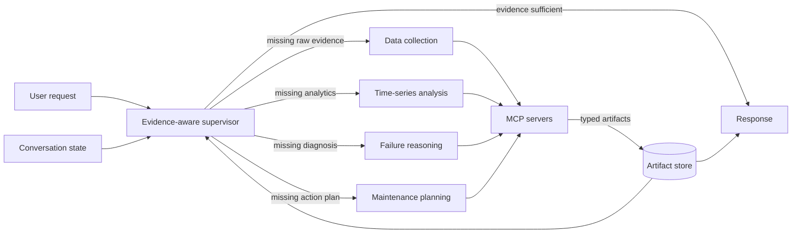

# Interactive Industrial Operations and Maintenance with Cross-Turn Evidence Reuse

Multi-Turn AssetOps is an interactive multi-agent system for industrial operations and maintenance (O&M). It preserves tool outputs as structured, reusable evidence so later dialogue turns can continue an investigation without repeating expensive data retrieval and time-series analysis.

The system uses an evidence-aware supervisor and four domain specialists for data collection, time-series analysis, failure reasoning, and maintenance planning. Industrial tools are exposed through Model Context Protocol (MCP) servers and operate over IoT, work-order, failure-mode, and time-series data.

## Why cross-turn evidence reuse?

Industrial investigations are iterative. A user may first ask whether a chiller is behaving abnormally, then ask what caused the anomaly, and finally ask which explanation best fits the evidence. A conventional agent can repeat retrieval and analysis on every turn. Multi-Turn AssetOps instead stores each useful result as a typed artifact with:

- a persistent artifact ID;
- asset and time-window metadata;
- the producing specialist and source tools;
- a structured payload and concise summary;
- references to upstream artifacts.

The supervisor inspects these artifacts before every decision. It can reuse existing evidence, dispatch only the specialist needed to fill a gap, or answer directly when the evidence is sufficient.

## System architecture



| Component | Responsibility | Typical artifacts |
| --- | --- | --- |
| Supervisor | Assesses evidence, routes work, and decides when to stop | Routing decisions and final responses |
| Data Collection Specialist | Retrieves assets, sensors, histories, events, and work orders | `inventory`, `dataset_ref` |
| Time-Series Analysis Specialist | Computes statistics, anomaly detection, forecasting, and fine-tuning | `analysis_result` |
| Failure Reasoning Specialist | Maps observed behavior to failure modes and competing diagnoses | `reasoning_result` |
| Maintenance Planning Specialist | Produces recovery, verification, and maintenance actions | `planning_result`, `draft_action` |

The default MCP servers are:

- `iot` for sites, assets, sensors, and historical measurements;
- `wo` for work orders, events, alerts, and failure codes;
- `tsfm` for forecasting, anomaly detection, and TSFM fine-tuning;
- `fmsr` for failure-mode and sensor mappings;
- `utilities` for CSV statistics, JSON reading, and date/time utilities.

## Example investigation

The paper demonstration follows Chiller 6 at Site `MAIN` across three turns:

1. **Detect the problem.** The system retrieves sensor data and performs anomaly analysis, creating reusable data and analysis artifacts.
2. **Explain the problem.** The supervisor reuses those artifacts and requests only the missing failure reasoning and supporting statistics.
3. **Compare the causes.** The accumulated evidence already supports the answer, so the supervisor responds without another tool call.

This illustrates the main execution policy: stored evidence guides both specialist selection and termination.

## Getting started

### Requirements

- Python 3.12+
- [`uv`](https://docs.astral.sh/uv/)
- Docker, for the local CouchDB service
- credentials for IBM WatsonX, TokenRouter, or a LiteLLM-compatible endpoint

### Install

```bash
git clone https://github.com/Coderlicr/Multi-Turn-AssetOps.git
cd Multi-Turn-AssetOps
uv sync
cp .env.example .env
```

Configure one model provider in `.env`. For WatsonX:

```dotenv
DEFAULT_MODEL_ID=watsonx/meta-llama/llama-4-maverick-17b-128e-instruct-fp8
WATSONX_APIKEY=your-api-key
WATSONX_PROJECT_ID=your-project-id
WATSONX_URL=https://us-south.ml.cloud.ibm.com
```

`tokenrouter/<model>` and `litellm_proxy/<model>` identifiers are also supported through `TOKENROUTER_*` and `LITELLM_*` credentials. See [`.env.example`](.env.example) for all settings.

### Start the data services

The repository includes work-order data, a Chiller 6 sample, and vibration data. The full evaluation dataset expects `main.json` under `src/couchdb/sample_data/iot/`.

```bash
docker compose -f src/couchdb/docker-compose.yaml up -d
uv run python src/couchdb/check_couchdb_data.py
```

The default databases are `chiller`, `workorder`, and `vibration` at `http://localhost:5984`.

## Run the agents

### Supervisor–Specialist

Run a single turn:

```bash
uv run supervisor-specialist \
  --reference-date 2020-06-20 \
  "Investigate unusually high temperature on Chiller 6 at Site MAIN over the past month."
```

Start a multi-turn session:

```bash
uv run supervisor-specialist --multi-turn --reference-date 2020-06-20
```

Example conversation:

```text
> Is Chiller 6 behaving abnormally over the past month?
> What could be causing this during the same period?
> Which cause best fits the data?
```

Enable independent specialist tool calls in parallel:

```bash
uv run supervisor-specialist \
  --parallel \
  --reference-date 2020-06-20 \
  "Compare Chiller 3, Chiller 4, Chiller 6, and Chiller 9 over the past month."
```

Cross-turn state is controlled with `--reuse-mode`:

| Mode | Behavior |
| --- | --- |
| `full` | Reuses dialogue memory and structured artifacts across turns; default |
| `none` | Keeps natural-language dialogue memory but hides artifacts from earlier turns |
| `stateless` | Drops all cross-turn state |

Run the no-reuse ablation:

```bash
uv run supervisor-specialist \
  --multi-turn \
  --reuse-mode none \
  --reference-date 2020-06-20
```

### Plan–Execute baseline

```bash
uv run plan-execute \
  --show-plan \
  --show-history \
  --reference-date 2020-06-20 \
  "List the assets available at Site MAIN."
```

### Stirrup agent (ReAct Loop)

The optional Stirrup runner exposes the same default MCP server set. Its code-execution track is enabled by default; use `--no-code` for tools-only execution.

```bash
uv run stirrup-agent \
  --no-code \
  --reference-date 2020-06-20 \
  --model-id tokenrouter/<model-name> \
  "List the assets available at Site MAIN."
```

## Reproduce the evaluation

Run all 16 Supervisor–Specialist dialogues:

```bash
uv run python eval/run_eval.py \
  --system supervisor-specialist \
  --reuse-mode full
```

Run the no-reuse ablation:

```bash
uv run python eval/run_eval.py \
  --system supervisor-specialist \
  --reuse-mode none
```

Run selected dialogues or override the model:

```bash
uv run python eval/run_eval.py \
  --dialogs 1 6 12 \
  --model-id watsonx/meta-llama/llama-4-maverick-17b-128e-instruct-fp8
```

The harness writes per-dialog responses, LLM/tool/CouchDB metrics, behavior logs, and `summary.json` under `eval/results/<run-id>/`. Profiling integrations for Weights & Biases and LangSmith are optional; configuration is documented in [PROFILING.md](PROFILING.md).

Dedicated entry points are also available for the architecture-specific evaluation runners:

```bash
uv run python eval/run_plan_execute_eval.py
uv run python eval/run_supervisor_specialist_eval.py
```

## Repository layout

```text
.
├── eval/                              # 16 dialogue scenarios and evaluation runners
├── src/
│   ├── agent/
│   │   ├── plan_execute/              # Plan–Execute baseline
│   │   ├── stirrup_agent/             # Optional Stirrup runner
│   │   └── supervisor_specialist/     # Supervisor, specialists, graph, and artifact store
│   ├── couchdb/                       # Local CouchDB setup and sample data
│   ├── llm/                           # LiteLLM backend and provider routing
│   └── servers/                       # MCP servers: IoT, WO, TSFM, FMSR, utilities, vibration
├── DESIGN.md                          # Scenario and system design notes
├── INSTRUCTIONS.md                    # Detailed usage documentation
├── PROFILING.md                       # Metrics and profiling setup
└── pyproject.toml                     # Dependencies and CLI entry points
```

## License

Released under the [Apache License 2.0](LICENSE).
